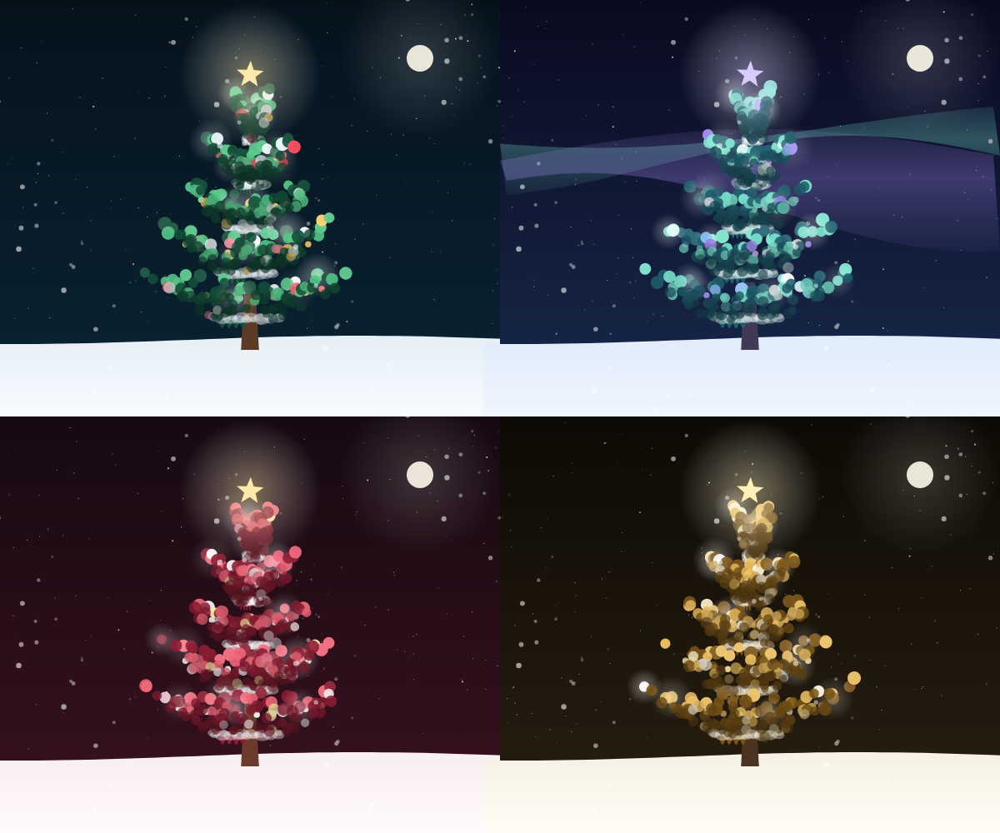

# christmas qr

Turn any link into a Christmas tree that **is** a scannable QR code.

A rebuild of the [xmasqr](https://xmasqr.vercel.app/?tree=classic) tree site, written from
scratch in React + Canvas, with two extras on top of the original:

- **Send a tree** — share your own tree, invite a friend to grow one for you, or plant a tree
  somebody sent by pasting a link or photographing its code.
- **Embed anywhere** — an iframe snippet, a one-file `<script>` widget, or a direct link, so the
  tree can live inside any site.

## Quick start

```bash
npm install
npm run dev      # http://localhost:5173
npm run build    # dist/ + dist/embed.js
npm run verify   # scan + embed + receive checks, no browser needed
```



## How the tree works

Every dark module of the QR code becomes a blossom. While the tree is standing, blossoms float on
the branch skirts of a spruce silhouetted from the seed of the payload; tap the tree and each one
falls onto its own module, the snow brightens, and the platform becomes a plain, scannable code.
Tap again and the tree grows back — both directions are reversible mid-flight.

Two details make it actually scan:

- **Integer-aligned modules.** The flat code is laid out at a whole-pixel cell size and every
  landed module is snapped to the pixel grid. Fractional module edges are the usual reason a
  pretty QR code fails on a phone.
- **Error correction `M` with a full quiet zone**, so the ornaments that are still in the air
  during the tween, or a thumb over one corner, do not break the read.

`npm run verify` renders the flat frame at several sizes and decodes it with jsQR, which is the
same sanity check CI would run.

## Sharing

| Flow | What happens |
| --- | --- |
| **Share my tree** | Builds `?t=<style>&u=<payload>&m=<greeting>`. Sends through the native share sheet, Telegram/WhatsApp, or the clipboard. Exports a card PNG, a plain code PNG or an SVG. |
| **Invite a friend** | Sends a bare tree link. Your friend opens it, enters their own link, and sends the resulting tree back. |
| **Receive a tree** | Paste a link, or upload a screenshot/photo of a QR code — jsQR reads it in the browser, no upload to a server. Received trees are kept in a local inbox (`localStorage`) and can be re-opened later, with the chime and confetti on first reveal. |

## Embedding

**iframe** — `?embed=1` renders a chromeless tree that is itself tappable:

```html
<div style="max-width:720px;margin:0 auto">
  <iframe
    src="https://your-site/?t=classic&u=https%3A%2F%2Fexample.com&embed=1"
    style="width:100%;height:640px;border:0;border-radius:18px"
    loading="lazy"
  ></iframe>
</div>
```

**script widget** — one self-contained file, no framework needed on the host page:

```html
<div id="xmas-tree"></div>
<script src="https://your-site/embed.js?t=aurora&u=https%3A%2F%2Fexample.com" async></script>
```

Query parameters: `t` (tree style), `u` (payload the code encodes), `m` (greeting), `embed=1`
(chromeless), `view=code` (start flat), `mount` (placeholder id for the script widget), `h`
(widget height).

If `u` is omitted, the code points back at the tree itself.

## URL parameters

| Param | Meaning |
| --- | --- |
| `u` / `url` | payload behind the QR code |
| `m` / `msg` | greeting shown on the card |
| `t` / `tree` | `classic`, `aurora`, `candy`, `gold` |
| `embed` | `1` hides the site chrome (for iframes) |
| `view` | `code` starts on the flat code instead of the tree |

## Project layout

```
src/
  lib/qr.ts         QR encoding (UTF-8 payloads, EC level, SVG export)
  lib/scene.ts      the canvas renderer: sky, snow, tree, morph
  lib/looks.ts      the four tree palettes
  lib/urlState.ts   share-link parsing and building
  lib/export.ts     card PNG / code PNG / SVG / embed snippets
  lib/celebrate.ts  chime + confetti, no dependencies
  lib/store.ts      local inbox
  components/       Stage (canvas + tap), ShareDialog, EmbedDialog
  embed.ts          the drop-in widget, built to dist/embed.js
scripts/
  verify-scan.mjs   headless render + jsQR decode
  build-embed.mjs   bundles the widget as a single IIFE
```

Everything runs in the browser: no accounts, no analytics, no server calls. Trees are drawn on
the fly, and the local inbox never leaves the device.
